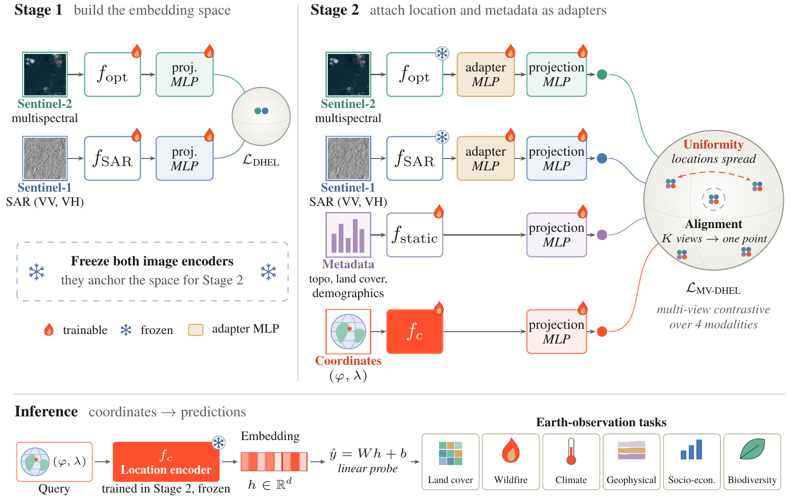
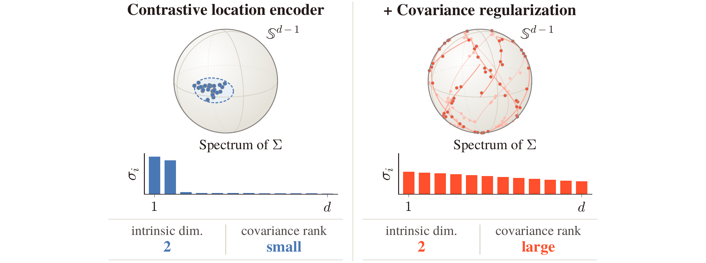

# 🌍 LoCA: Enabling Multi-Modality in Geospatial Location Encoders


**LoCA** (**Lo**cation **C**ontrastive **A**lignment) turns Sentinel-1 + Sentinel-2 + metadata into one location embedding, queried from (lat, lon) alone.

> 🚧 **Code coming soon.** ⭐ Star or watch the repo to get notified.



## ✨ Highlights

| 🥇 Best on | 🥈 Top-2 on | ⚔️ Pairwise win rate vs. 5 encoders | 📈 Effective rank |
|:---:|:---:|:---:|:---:|
| **8 / 17** tasks | **11 / 17** tasks | **68.8%** | **62%** of dims (SatCLIP 35%) |

- 📐 **Theory.** Location encoders provably keep contrastive learning away from its optimum.
- 🔁 **Reframing.** SatCLIP-style encoders work because the frozen image encoder acts as a high-rank covariance regularizer.
- 🛰️ **Method.** Stage 1 co-aligns Sentinel-1 and Sentinel-2 encoders with contrastive learning. Stage 2 fits location and metadata encoders onto them with multi-view contrastive learning.

## 🔍 Why it works



The intrinsic dimension of a location encoder is at most 2, but its covariance rank is not bounded and follows the target it is fitted to.

| Method | Target | Effective rank | % of dims |
|:---|:---|:---:|:---:|
| SatCLIP (from scratch) | none | 8 | 3.1% |
| SatCLIP | MoCo ResNet-50 (S2) | 89 | 34.9% |
| Copernicus-FM | DINOv2 | 158 | 20.6% |
| **LoCA** | **Stage 1 (S1 + S2)** | **158** | **62.0%** |

## 🗺️ Release plan

- ⏳ Training code (Stage 1 + Stage 2)
- ⏳ Pretrained LoCA location encoder weights
- ⏳ Pretraining dataset (S2-100K + co-located Sentinel-1 + 14 metadata variables)
- ⏳ Evaluation suite for the 17 benchmark tasks

## 📝 Citation

```bibtex
@article{koromilas2026loca,
  title   = {{LoCA}: Enabling Multi-Modality in Geospatial Location Encoders},
  author  = {Koromilas, Panagiotis and Vali, Eleanna and Antonopoulos, Diogenis and Saka, Eleni and Christofis, Dimitris and Bountos, Nikolaos Ioannis and Klemmer, Konstantin and Papoutsis, Ioannis and Panagakis, Yannis and Nicolaou, Mihalis},
  journal = {arXiv preprint arXiv:XXXX.XXXXX},
  year    = {2026}
}
```

## 🙏 Acknowledgments

Built on [SatCLIP](https://github.com/microsoft/satclip), [TorchGeo](https://github.com/microsoft/torchgeo) and the [multi-view contrastive learning framework](https://arxiv.org/abs/2507.06979).

Supported by the EuroHPC JU and the Greek Ministry of Digital Governance and Artificial Intelligence (Pharos, GA 101234269), TensorICE (EXCELLENCE/0524/0407, THALIA 2021–2027), the ARCHIMEDES Unit (OPS 5154714, Greece 2.0 – NextGenerationEU), and the Horizon Europe projects ThinkingEarth (GA 101130544) and PROTEUS (GA 101296397). Computing time was provided by the Cyclone supercomputer of The Cyprus Institute. Konstantin Klemmer thanks Taylor Geospatial for their support.
